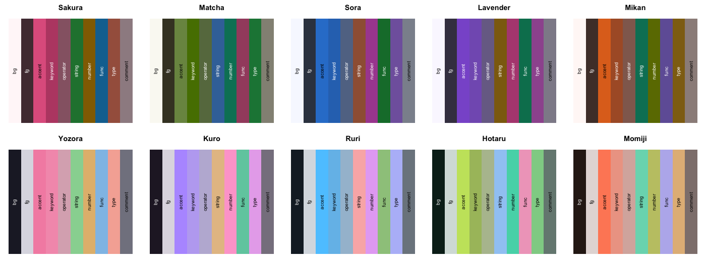
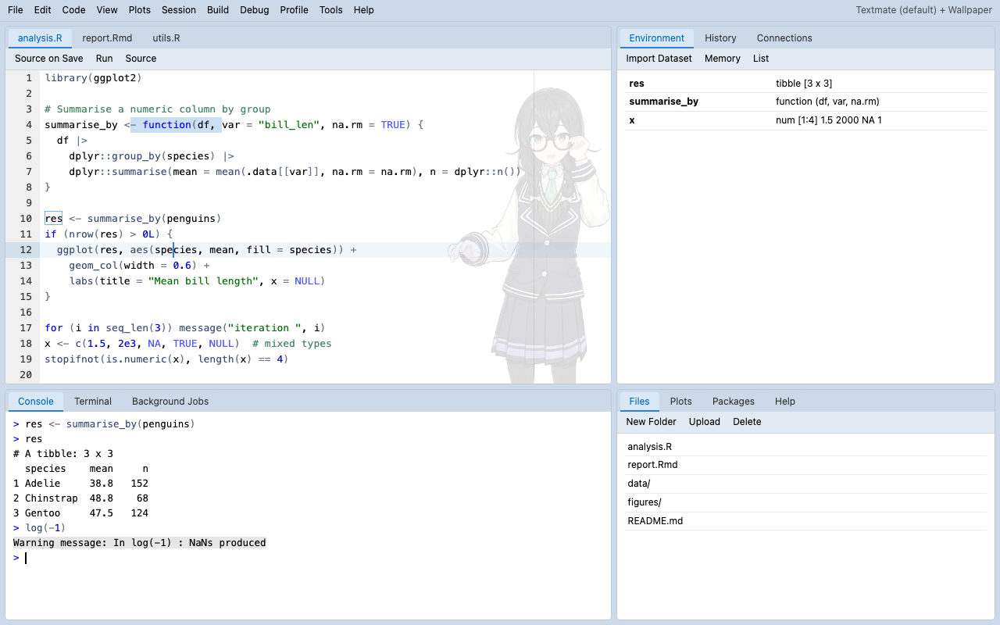

# rswallpaper 🌸

<!-- badges: start -->
[](https://github.com/Acidic3131/rswallpaper/actions/workflows/R-CMD-check.yaml)

<!-- badges: end -->

**给 RStudio 的编辑区放一张半透明二次元立绘，再一键换上整体主题色。**

[English README](README_en.md)

| 浅色：Matcha 配色 + 立绘 | 深色：自定义灰绿 + 藤紫配色 + 立绘 |
|---|---|
|  |  |

> 截图里的角色是 [小樽潮風高校Project](https://tokyo6.tokyo/) 的「花隈千冬」（© TOKYO6 ENTERTAINMENT），免费公开立绘，作为示例图收录在 `inst/extdata/hanakuma_chifuyu.png`。换成你自己的角色立绘就行。
>
> 深色图是低饱和灰绿底 + 藤紫色强调（呼应裙摆的紫色条纹），一行代码生成：`rs_palette("#B3AEDB", dark = TRUE, bg = "#1D2220", bg_hue = 150)`。

## 功能

- 🖼️ **编辑区立绘背景**：支持 PNG / JPG / WebP / GIF / SVG，可以调透明度、大小、位置、渐隐方向和 CSS 滤镜（模糊、饱和度等）。
- 🧅 **两种叠放模式**：`overlay` 把图盖在代码上（最稳）；`behind` 把图垫在文字下面，代码更清晰，可以用更高的透明度。
- 🎨 **整体主题色**：一个强调色同时改光标、选区、当前行、标签页、面板菜单、工具栏和滚动条；`accent = "auto"` 直接从立绘取色。
- 🌈 **10 套内置配色**，也可以用一个颜色生成整套配色（`rs_palette()`），或者让立绘自动生成配色（`theme = "auto"`）。所有代码颜色都保证 WCAG 4.5:1 对比度。
- 🧩 **可以叠在任何主题上**：已安装的 [rsthemes](https://github.com/gadenbuie/rsthemes)、[rstudiothemes](https://github.com/dieghernan/rstudiothemes)、RStudio 自带主题，或者 `.rstheme` / `.tmTheme` 文件。
- 🪟 **Wallpaper Studio**：可视化面板，边调边看预览，一键应用（也在 Addins 菜单里）。
- 🔀 **随机换图**：给一个文件夹，每次打开 RStudio 自动换一张。
- ↩️ **一键还原、一键清理**，不会留下乱七八糟的主题。

## 安装

```r
# install.packages("remotes")
remotes::install_github("Acidic3131/rswallpaper")

# 推荐一起装：自动压缩大图 / 从图片取色 / 可视化面板
install.packages(c("magick", "shiny", "miniUI"))
```

需要 RStudio ≥ 1.2（建议用较新版本）和 R ≥ 4.0。

## 快速开始

```r
library(rswallpaper)

# 0. 先用自带的示例立绘试试效果
demo <- system.file("extdata", "hanakuma_chifuyu.png", package = "rswallpaper")
set_wallpaper(demo, theme = "matcha", mode = "behind", opacity = 0.45, tint = 0.6)

# 1. 在当前主题上放一张立绘
set_wallpaper("~/Pictures/chifuyo.png")

# 2. 指定底层主题、强调色和叠放方式
set_wallpaper(
  "~/Pictures/chifuyo.png",
  theme   = "OKSolar Light",   # 任意已安装主题，见 list_themes()
  accent  = "#7AA2F7",         # 或 "auto"：从立绘取色
  mode    = "behind",          # 图垫在文字下面
  opacity = 0.3,
  fade    = "left"             # 立绘靠右，往左渐隐，左边写代码的区域保持干净
)

# 3. 用立绘的颜色生成整套深色主题
set_wallpaper("~/Pictures/chifuyo.png", theme = "auto-dark")

# 4. 只换颜色，不放图
set_wallpaper(theme = "sakura")

# 不满意？一键回到原来的主题
restore_theme()
```

也可以直接打开可视化面板：

```r
wallpaper_studio()   # 或者 Addins 菜单 → Wallpaper Studio
```


选 *Custom* 强调色时，除了取色器还有分组色卡：从立绘里提取的颜色、10 套内置配色的主色，以及 **和色**（紅梅、浅葱、瑠璃、利休鼠……）、**Muted**（莫兰迪 / 胶片色调）、**Jewel**（宝石色）和 **Pastel**（马卡龙色）。鼠标悬停可以看到颜色名和色值。

## 参数一览

| 参数 | 作用 | 默认值 |
|---|---|---|
| `img` | 图片路径、**文件夹**（随机挑一张）、URL，或 `NULL`（不放图） | `NULL` |
| `theme` | 底层主题：当前主题 / 已安装主题名 / 内置配色名 / `"auto"` / `"auto-dark"` / 文件路径 / `rs_palette()` | 当前主题 |
| `accent` | 强调色，`"auto"` 从图片取色，`NULL` 保持原主题 | `NULL` |
| `opacity` | 图片不透明度 0–1 | overlay 0.18，behind 0.28 |
| `position` | CSS `background-position`，如 `"right bottom"`、`"center"`、`"right 24px bottom 0"` | `"right bottom"` |
| `size` | 0–1 的数字表示占编辑区高度的比例；或 `"contain"`、`"cover"`、`"auto 60%"` | `0.75` |
| `mode` | `"overlay"`（盖在代码上）/ `"behind"`（垫在文字下） | `"overlay"` |
| `fade` | 往哪个方向渐隐：`"none"`、`"left"`、`"right"`、`"top"`、`"bottom"` | `"none"` |
| `filter` | CSS 滤镜，如 `"blur(1px) saturate(1.2)"` | `NULL` |
| `target` | `"source"` 只在源码编辑器显示；`"any"` 所有代码编辑器（除 Console） | `"source"` |
| `tint` | 强调色对标签页、工具栏等界面的染色强度 0–1 | `0.35` |
| `name` | 主题名，同名再次运行会直接替换 | `"<底层主题> + Wallpaper"` |
| `max_px` | 超过这个像素的图会被缩小并转成 WebP 再嵌入（需要 magick） | `1600` |

## 选择整体主题颜色

有三种方式，可以混用：

**① 内置配色**：`palettes()` 查看全部，`theme = "名字"` 使用。



| 浅色 | 含义 | 深色 | 含义 |
|---|---|---|---|
| `sakura` | 樱花粉 | `yozora` | 夜空，藏青底 + 粉色 |
| `matcha` | 抹茶拿铁，奶油底 + 灰绿 | `kuro` | 黑猫，紫色 |
| `sora` | 晴空蓝 | `ruri` | 琉璃，青蓝 |
| `lavender` | 薰衣草紫 | `hotaru` | 萤火，黄绿 |
| `mikan` | 蜜柑橙 | `momiji` | 红叶，橙红 |

**② 自定义配色**：给一个主色就能生成完整的语法高亮配色，单个颜色也能覆盖。

```r
p <- rs_palette("#4FB0A5", dark = TRUE, name = "Teal Night", string = "#F7C873")
plot(p)                                   # 预览色板
set_wallpaper("~/Pictures/miku.png", theme = p)
```

**③ 保留喜欢的主题，只换强调色**：

```r
set_wallpaper(theme = "Tokyo Night", accent = "#F7768E", tint = 0.5)
```



## 每次打开 RStudio 随机换一张

先用一个**文件夹**设置一次：

```r
set_wallpaper("~/Pictures/rstudio-wallpapers/", theme = "yozora", mode = "behind", fade = "left")
```

然后在 `~/.Rprofile`（可以用 `usethis::edit_r_profile()` 打开）里加上：

```r
setHook("rstudio.sessionInit", function(newSession) {
  if (newSession) rswallpaper::shuffle_wallpaper()
}, action = "append")
```

手动换下一张：`shuffle_wallpaper()`，或 Addins → *Shuffle wallpaper*。

## 预览、导出和管理

```r
preview_theme("~/Pictures/chifuyo.png", theme = "sakura")   # 在 Viewer/浏览器里看效果，不改 IDE
build_theme("~/Pictures/chifuyo.png", theme = "sakura",
            file = "sakura-chifuyo.rstheme")                 # 只导出 .rstheme，可以分享
image_colors("~/Pictures/chifuyo.png")                       # 看看立绘的主色
list_themes()                                                # 所有可用的底层主题
list_wallpapers()                                            # rswallpaper 生成过的主题
remove_wallpapers()                                          # 全部删掉
restore_theme(remove = TRUE)                                 # 还原并清理
```

## 原理

RStudio 的主题（`.rstheme`）本质上是一份 CSS。rswallpaper 读取底层主题，在末尾追加一段带标记的 CSS：

- 立绘以 base64 data URI 嵌进主题文件，所以不依赖外部文件路径；
- `overlay` 模式用源码编辑器（`#rstudio_source_text_editor`）上的 `::after` 伪元素铺一层半透明图片，`pointer-events: none` 保证鼠标照常点击；
- `behind` 模式把图片放在 Ace 编辑器的 `.ace_scroller::before` 上，位于背景色之上、文字层之下，并把当前行等不透明色块改成半透明；
- 强调色复用 RStudio 主题文件里面向界面的选择器（`rstheme_tabLayoutCenter`、`rstheme_toolbarWrapper` 等）给界面染色。


*左：overlay，图片盖在代码上；右：behind，代码在图片上方保持清晰（真实 Ace 编辑器渲染）。*

追加的 CSS 包在 `/* rswallpaper:begin */ … /* rswallpaper:end */` 之间，所以拿生成的主题当底层再生成一次也不会叠出两张图。

## 常见问题

**图片没出现？**
确认是在源码编辑器（不是 Console）里看；可以试试 `target = "any"`。如果之前已经应用过同名主题，rswallpaper 会先切到别的主题再切回来强制刷新，仍然不变的话重启一下 RStudio。

**之前用自己的脚本（或别的工具）做过带立绘的主题？**
可以直接拿它当底层：rswallpaper 会自动去掉底层主题里旧的立绘规则（`::before` / `::after` 上的图片），并在控制台提示一句，不会叠出两张图，主题文件也不会越来越大。同名但不是 rswallpaper 生成的主题不会被覆盖。

**RStudio 变卡 / 主题文件很大？**
安装 `magick` 后会把超过 `max_px` 的图片自动缩小并转成 WebP。也可以先自己把图裁成合适大小。

**可视化编辑模式（Visual mode）里没有背景？**
那个编辑器不是 Ace，目前只支持源码模式。

**顶部菜单栏没变色？**
RStudio 桌面版的应用菜单是系统原生菜单，主题改不了；面板里的弹出菜单、标签页、工具栏会跟着变。

**图片版权**：请使用你有权使用的图片；分享 `.rstheme` 文件时，图片也会一起被分享出去。

## 相关项目

- [rsthemes](https://github.com/gadenbuie/rsthemes)：大量精心制作的 RStudio 主题，支持亮/暗切换、按时间自动切换。`rsthemes::install_rsthemes()` 安装后可直接作为 rswallpaper 的底层主题。
- [rstudiothemes](https://github.com/dieghernan/rstudiothemes)（CRAN）：把 VS Code / Positron / TextMate 主题转换成 RStudio 主题，并自带 Tokyo Night、Catppuccin、Dracula 等移植版。`rstudiothemes::install_rstudiothemes()`。
- [rscodeio](https://github.com/anthonynorth/rscodeio)：VS Code 风格的 RStudio 皮肤，还会修改 RStudio 安装目录里的菜单样式（需要管理员权限）。
- [tmTheme Editor](https://tmtheme-editor.linuxbox.ninja/)：在线编辑/下载 tmTheme，导出后可以用 `set_wallpaper(theme = "xxx.tmTheme")` 作为底层。

## 开发

```r
devtools::test()             # 单元测试
devtools::check()            # R CMD check
source("data-raw/figures.R") # 重新生成 README 截图（需要 Chrome + magick）
```

## 许可

代码以 MIT 许可发布 © rswallpaper authors。

示例立绘 `inst/extdata/hanakuma_chifuyu.png` 是 [小樽潮風高校Project](https://tokyo6.tokyo/) 角色「花隈千冬」的免费公开立绘，著作权归合同会社 TOKYO6 ENTERTAINMENT 所有（© TOKYO6 ENTERTAINMENT），**不在 MIT 许可范围内**。收录时只裁掉了透明边缘。使用须遵守 [キャラクター使用ガイドライン](https://tokyo6.tokyo/guidelines/)：个人、同人社团的非商用使用可以；法人使用或商用须另行取得许可；禁止用于政治、歧视、攻击特定个人或团体等用途，以及严重损害角色形象的用途。详见 `inst/extdata/CREDITS`。
