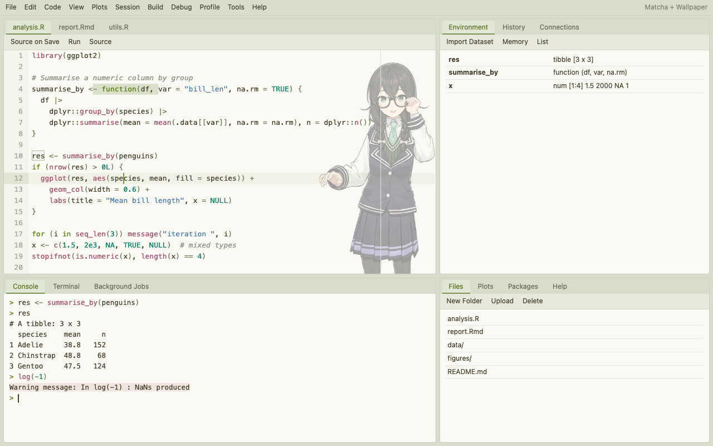
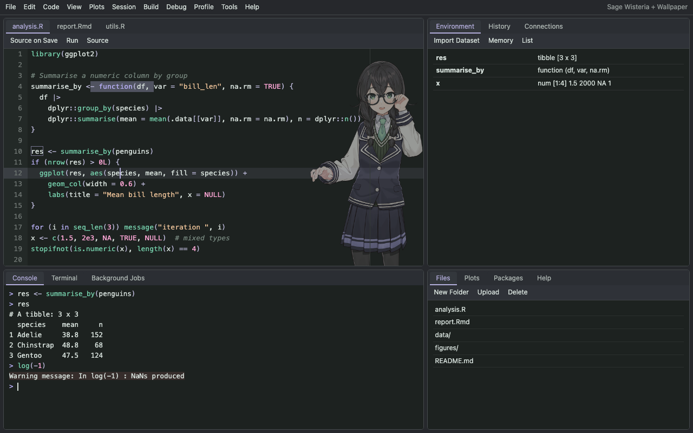
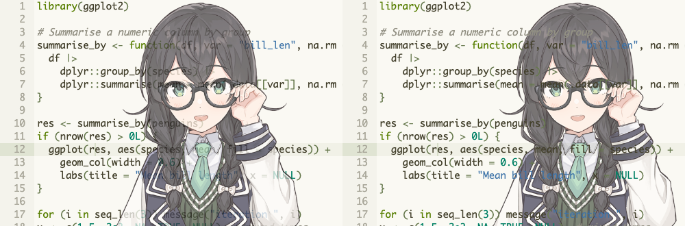

# rswallpaper 🌸

**Put a semi-transparent character illustration in the RStudio editor and re-colour the whole IDE in one call.**

[中文说明](README.md)

| Light: Matcha palette + wallpaper | Dark: custom grey-green + wisteria palette + wallpaper |
|---|---|
|  |  |

## Features

- **Editor wallpaper** from PNG / JPG / WebP / GIF / SVG with opacity, size, position, fade and CSS filters.
- **Two layering modes**: `overlay` (image above the code, most robust) and `behind` (image under the text, code stays crisp).
- **Accent colour** for cursor, selection, active line, tabs, pane menus, toolbars and scrollbars; `accent = "auto"` picks it from the image.
- **10 preset palettes**, custom palettes from one colour (`rs_palette()`), or a palette generated from the image (`theme = "auto"`). Code colours meet WCAG 4.5:1 contrast.
- Works on top of **any theme**: installed ones (rsthemes, rstudiothemes), RStudio's built-ins, or `.rstheme` / `.tmTheme` files.
- **Wallpaper Studio** gadget/addin with live preview.
- **Random wallpaper** from a folder on every session start.
- One-call **restore** and clean-up.

## Installation

```r
remotes::install_github("Acidic3131/rswallpaper")
install.packages(c("magick", "shiny", "miniUI"))  # recommended extras
```

## Usage

```r
library(rswallpaper)

demo <- system.file("extdata", "hanakuma_chifuyu.png", package = "rswallpaper")
set_wallpaper(demo, theme = "matcha", mode = "behind")        # try the bundled demo
set_wallpaper("~/Pictures/chifuyo.png")                       # on your current theme
set_wallpaper("~/Pictures/chifuyo.png", theme = "OKSolar Light",
              accent = "auto", mode = "behind", opacity = 0.3, fade = "left")
set_wallpaper("~/Pictures/chifuyo.png", theme = "auto-dark")  # palette from the image
set_wallpaper(theme = "sakura")                               # colours only
wallpaper_studio()                                            # interactive editor
restore_theme()                                               # undo
```

Random image per session — call `set_wallpaper()` once with a folder, then add to `~/.Rprofile`:

```r
setHook("rstudio.sessionInit", function(newSession) {
  if (newSession) rswallpaper::shuffle_wallpaper()
}, action = "append")
```

Other helpers: `preview_theme()`, `build_theme()` (write an `.rstheme` without installing it),
`palettes()`, `rs_palette()`, `palette_from_image()`, `image_colors()`, `list_themes()`,
`list_wallpapers()`, `remove_wallpapers()`.

## How it works

An `.rstheme` file is CSS. rswallpaper takes the base theme and appends a marked block: the image is
embedded as a data URI and drawn with a `::after` layer on the source editor (`overlay`) or a
`.ace_scroller::before` layer beneath Ace's text layer (`behind`); accent colours reuse the IDE
selectors RStudio themes use (`rstheme_tabLayoutCenter`, `rstheme_toolbarWrapper`, ...).



## Related projects

[rsthemes](https://github.com/gadenbuie/rsthemes) ·
[rstudiothemes](https://github.com/dieghernan/rstudiothemes) ·
[rscodeio](https://github.com/anthonynorth/rscodeio) ·
[tmTheme Editor](https://tmtheme-editor.linuxbox.ninja/)

## License

Code: MIT. The demo illustration `inst/extdata/hanakuma_chifuyu.png` is the free standing illustration of Hanakuma Chifuyu from the [Otaru Shiokaze High School Project](https://tokyo6.tokyo/), © TOKYO6 ENTERTAINMENT. It is **not** covered by the MIT licence; use it according to the [character usage guidelines](https://tokyo6.tokyo/guidelines/) (personal non-commercial use is allowed, corporate or commercial use needs separate permission). See `inst/extdata/CREDITS`.
