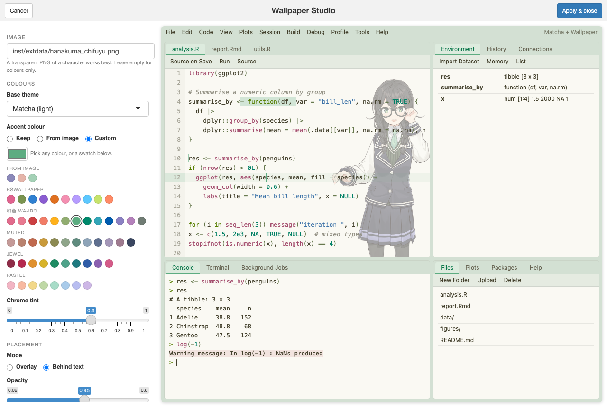

# rswallpaper

<!-- badges: start -->
[](https://github.com/Acidic3131/rswallpaper/actions/workflows/R-CMD-check.yaml)

<!-- badges: end -->

**Customise RStudio's theme colours and put a semi-transparent illustration in the editor**

[README 简体中文版](README.md)

| Light: Matcha palette + wallpaper | Dark: custom grey-green + wisteria palette + wallpaper |
|---|---|
|  |  |

> The character in the demo is Hanakuma Chifuyu from the [Otaru Shiokaze High School Project](https://tokyo6.tokyo/) (© TOKYO6 ENTERTAINMENT), a free public standing illustration, bundled as the demo image in `inst/extdata/hanakuma_chifuyu.png`.

## Features

- **Editor wallpaper**: PNG / JPG / WebP / GIF / SVG, with adjustable opacity, size, position, fade direction and CSS filters (blur, saturation, ...).
- **Two layering modes**: `overlay` lays the image over the code; `behind` puts it under the text, so the code stays crisp and you can use a higher opacity.
- **Overall theme colour**: one accent colour restyles the cursor, selection, active line, tabs, pane menus, toolbars and scrollbars; `accent = "auto"` takes it straight from the illustration.
- **10 built-in palettes**; you can also build a whole palette from a single colour (`rs_palette()`) or let the illustration generate one (`theme = "auto"`). Every code colour meets a WCAG contrast of 4.5:1.
- **Works on top of any theme**: installed [rsthemes](https://github.com/gadenbuie/rsthemes) or [rstudiothemes](https://github.com/dieghernan/rstudiothemes) themes, RStudio's built-in themes, or `.rstheme` / `.tmTheme` files.
- **Wallpaper Studio**: a visual editor.
- **Random wallpaper**: point it at a folder of images and RStudio shows a different one every time it starts.

## Installation

```r
# install.packages("remotes")
remotes::install_github("Acidic3131/rswallpaper")
library(rswallpaper)

# Recommended extras: shrink large images / pick colours from images / visual editor
install.packages(c("magick", "shiny", "miniUI"))
```

Requires RStudio ≥ 1.2 (a recent version is recommended) and R ≥ 4.0.

> Installing or reinstalling makes RStudio restart R, so run `library(rswallpaper)` again afterwards; otherwise you get `could not find function "wallpaper_studio"`.
> You can also skip loading it and call `rswallpaper::wallpaper_studio()`, or open *Wallpaper Studio* from the **Addins** menu.

## Quick start

```r
library(rswallpaper)

# 0. Try it out with the bundled demo illustration
demo <- system.file("extdata", "hanakuma_chifuyu.png", package = "rswallpaper")
set_wallpaper(demo, theme = "matcha", mode = "behind", opacity = 0.45, tint = 0.6)

# 1. Put an illustration on your current theme
set_wallpaper("~/Pictures/chifuyo.png")

# 2. Choose the base theme, accent colour and layering mode
set_wallpaper(
  "~/Pictures/chifuyo.png",
  theme   = "OKSolar Light",   # any installed theme, see list_themes()
  accent  = "#7AA2F7",         # or "auto": take it from the illustration
  mode    = "behind",          # image under the text
  opacity = 0.3,
  fade    = "left"             # image on the right, fading out to the left so the code area stays clean
)

# 3. Generate a complete dark theme from the illustration's colours
set_wallpaper("~/Pictures/chifuyo.png", theme = "auto-dark")

# 4. Colours only
set_wallpaper(theme = "sakura")

# Undo everything and go back to your previous theme
restore_theme()
```

You can also open the visual editor directly:

```r
wallpaper_studio()
```



With a *Custom* accent colour you get grouped swatches besides the colour picker: colours extracted from the illustration / the main colours of the 10 built-in palettes / Wa-iro / Muted / Jewel / Pastel. Hover over a swatch to see its name and hex value.

## Arguments

| Argument | What it does | Default |
|---|---|---|
| `img` | Image path, **folder** (one image picked at random), URL, or `NULL` (no image) | `NULL` |
| `theme` | Base theme: current theme / installed theme name / built-in palette name / `"auto"` / `"auto-dark"` / file path / `rs_palette()` | current theme |
| `accent` | Accent colour; `"auto"` takes it from the image, `NULL` keeps the base theme's colours | `NULL` |
| `opacity` | Image opacity, 0–1 | overlay 0.18, behind 0.28 |
| `position` | CSS `background-position`, e.g. `"right bottom"`, `"center"`, `"right 24px bottom 0"` | `"right bottom"` |
| `size` | A number from 0 to 1 is the share of the editor height; or `"contain"`, `"cover"`, `"auto 60%"` | `0.75` |
| `mode` | `"overlay"` (over the code) / `"behind"` (under the text) | `"overlay"` |
| `fade` | Direction to fade the image out: `"none"`, `"left"`, `"right"`, `"top"`, `"bottom"` | `"none"` |
| `filter` | CSS filter, e.g. `"blur(1px) saturate(1.2)"` | `NULL` |
| `target` | `"source"` shows the image in source editors only; `"any"` in every code editor except the Console | `"source"` |
| `tint` | How strongly the accent colour tints tabs, toolbars and other IDE chrome, 0–1 | `0.35` |
| `name` | Theme name; running again with the same name replaces the theme | `"<base theme> + Wallpaper"` |
| `max_px` | Images larger than this are shrunk and re-encoded as WebP before embedding (needs magick) | `1600` |

## A new picture every time RStudio starts

Set it up once with a folder:

```r
set_wallpaper("~/Pictures/rstudio-wallpapers/", theme = "yozora", mode = "behind", fade = "left")
```

Then add this to `~/.Rprofile` (open it with `usethis::edit_r_profile()`):

```r
setHook("rstudio.sessionInit", function(newSession) {
  if (newSession) rswallpaper::shuffle_wallpaper()
}, action = "append")
```

To switch to the next picture by hand: `shuffle_wallpaper()`, or Addins → *Shuffle wallpaper*.

## Preview, export and manage

```r
preview_theme("~/Pictures/chifuyo.png", theme = "sakura")   # preview in the Viewer/browser without touching the IDE
build_theme("~/Pictures/chifuyo.png", theme = "sakura",
            file = "sakura-chifuyo.rstheme")                 # only write the .rstheme, e.g. to share it
image_colors("~/Pictures/chifuyo.png")                       # main colours of the illustration
list_themes()                                                # every theme you can use as a base
list_wallpapers()                                            # themes generated by rswallpaper
remove_wallpapers()                                          # remove all of them
restore_theme(remove = TRUE)                                 # restore and clean up
```

## How it works

An RStudio theme (`.rstheme`) is essentially a CSS file. rswallpaper reads the base theme and appends a marked block of CSS:

- the illustration is embedded in the theme file as a base64 data URI, so it doesn't depend on any external file path;
- `overlay` mode lays a semi-transparent image over the source editor (`#rstudio_source_text_editor`) with a `::after` pseudo-element, and `pointer-events: none` keeps mouse clicks working;
- `behind` mode puts the image on the Ace editor's `.ace_scroller::before`, above the background colour and below the text layer, and turns opaque blocks such as the active line semi-transparent;
- the accent colour reuses the IDE selectors that RStudio theme files use (`rstheme_tabLayoutCenter`, `rstheme_toolbarWrapper`, ...) to tint the interface.


*Left: overlay, the image sits over the code. Right: behind, the code stays crisp on top of the image (rendered in a real Ace editor).*

The appended CSS is wrapped in `/* rswallpaper:begin */ … /* rswallpaper:end */`, so using a generated theme as the base again never stacks two images.

## Related projects

- [rsthemes](https://github.com/gadenbuie/rsthemes)
- [rstudiothemes](https://github.com/dieghernan/rstudiothemes)
- [rscodeio](https://github.com/anthonynorth/rscodeio)
- [tmTheme Editor](https://tmtheme-editor.linuxbox.ninja/)

## Development

```r
devtools::test()             # unit tests
devtools::check()            # R CMD check
source("data-raw/figures.R") # regenerate the README screenshots (needs Chrome + magick)
```

## License

The code is released under the MIT licence © rswallpaper authors.

The demo illustration `inst/extdata/hanakuma_chifuyu.png` is the free public standing illustration of Hanakuma Chifuyu from the [Otaru Shiokaze High School Project](https://tokyo6.tokyo/). Copyright belongs to TOKYO6 ENTERTAINMENT LLC (合同会社TOKYO6 ENTERTAINMENT, © TOKYO6 ENTERTAINMENT), and it is **not covered by the MIT licence**. Only its transparent margins were trimmed. Its use is governed by the [character usage guidelines](https://tokyo6.tokyo/guidelines/): non-commercial use by individuals and doujin circles is allowed; corporate or commercial use needs separate permission; use for political purposes, discrimination, attacks on specific people or groups, or anything that seriously damages the character's image is prohibited. See `inst/extdata/CREDITS`.
